# Assignment 3. Responsive Web Design (Media Queries + Bootstrap Grid)
**Name:** Akerke Berdakul  
**Group:** IT-2503

---
## Part 1 :Media Queries
### Task 0 : Responsive typography
o	Create a simple webpage with headings and paragraphs.
o	Use media queries to change font sizes for mobile, tablet, and desktop.
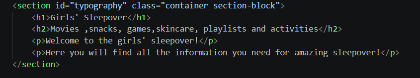
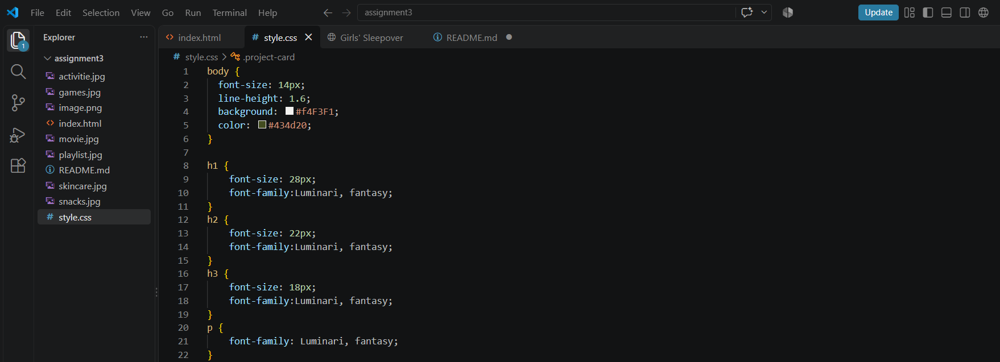

### Task 1. Responsive Layout with Media Queries
o	Create a webpage with three boxes in a row.
o	On desktop: display all three side by side.
o	On tablet: display two boxes in a row.
o	On mobile: display boxes stacked vertically.
o	Use only CSS media queries (no Bootstrap).
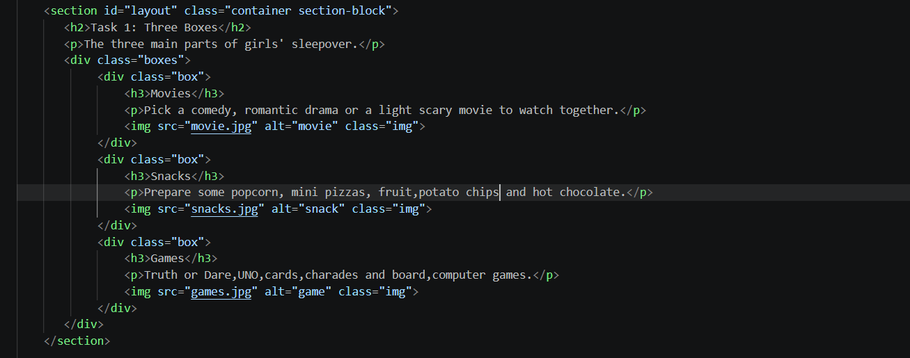
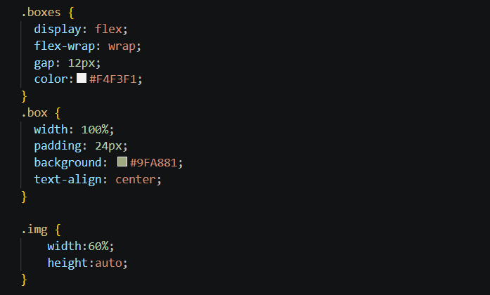

## Part 2. Bootstrap Grid System
### Task 2. Bootstrap Responsive Columns
•	Build a responsive layout using Bootstrap’s 12-column grid.
•	Create three columns:
o	On desktop: each column takes 4 columns (3 equal parts).
o	On tablet: two columns on the first row and one on the second row.
o	On mobile: all columns stacked.
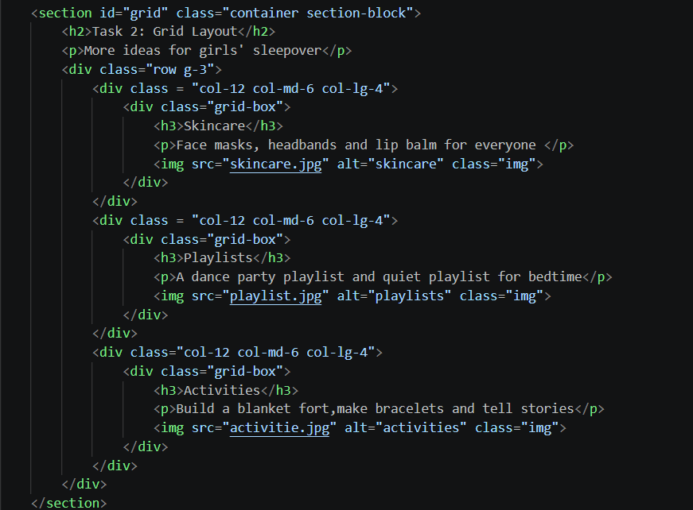
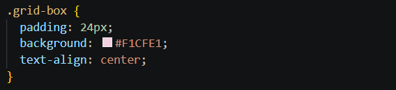

### Task 3. Bootstrap Navigation Bar
•	Create a responsive navigation bar using Bootstrap components.
•	It should include: a logo on the left, links on the right, and collapse into a hamburger menu on smaller screens.
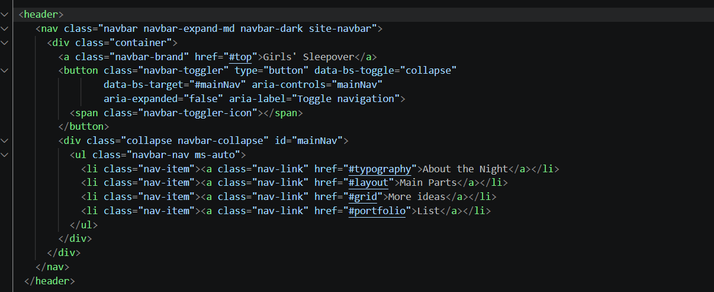
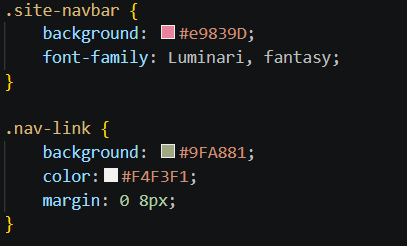

## Part 3. Combined Project
### Project

•	Create a portfolio page using both Media Queries and Bootstrap Grid.
•	Requirements:
1.	Header with a Bootstrap navbar.
2.	Main section divided into two parts:
	Left side: portfolio projects (use Bootstrap grid to arrange cards).
	Right side: sidebar with personal info and contact details.
3.	Footer across the bottom.
•	Apply custom media queries to adjust font sizes, spacing, and element visibility for mobile, tablet, and desktop.
•	Ensure that the page looks clean and usable across different screen sizes.
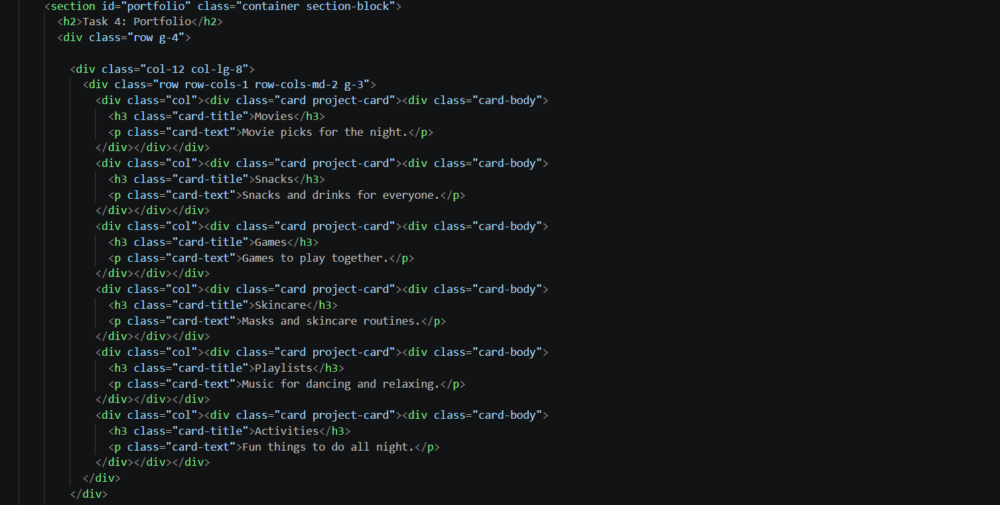
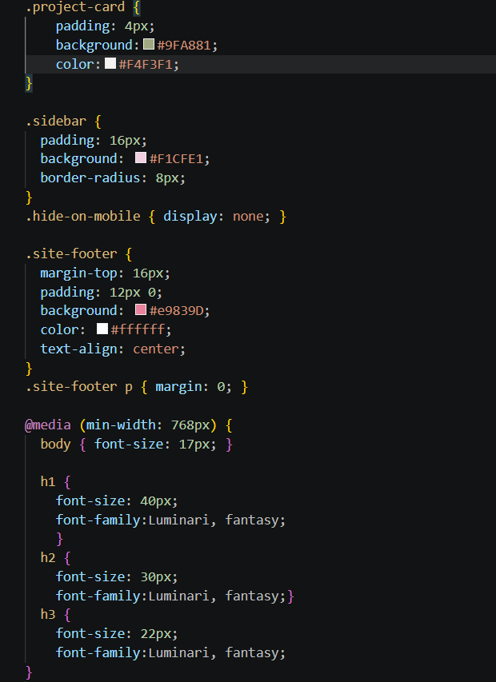
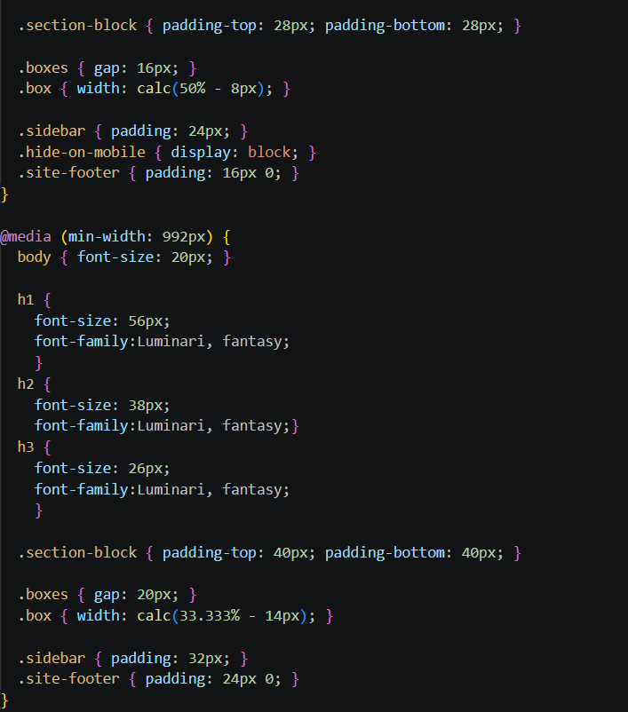

## Summary
The project shows how media queries and the Bootstrap grid work together. Media queries handle font sizes, spacing, visibility and the three-box layout, and Bootstrap handles the 12-column grid, cards and the collapsible navbar.
